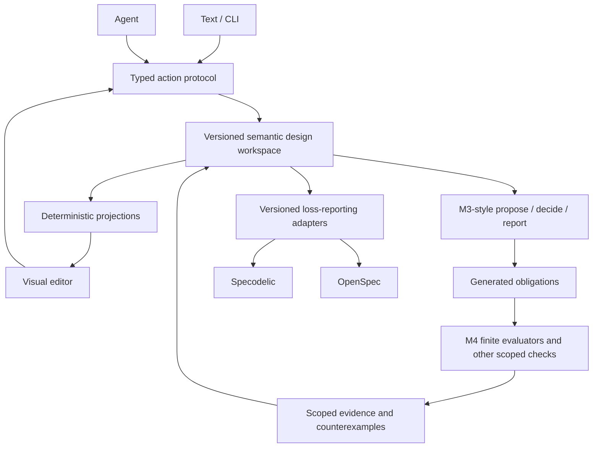

# Visual Semantic Software Design — Implementation and Verification Contract

## TL;DR

**Goal:** Provide a text-and-visual means of proposing, revising, and inspecting software designs while preserving semantic meaning, authority, and evidence. Start with a narrow, executable **order–payment–storage** vertical slice rather than a general visual modeling platform.

**Recommended architecture:** A versioned **design workspace** holds accepted commitments, proposals, evidence, revisions and typed design edits. M3 is the candidate design-event semantics; M4 is a limited finite contract/refinement evaluator. Both are experimental, not established production libraries. Specodelic and OpenSpec supply existing specification/checking and change-management capabilities via explicit, loss-reporting adapters. Visual diagrams are **derived views** and actions on the diagram invoke the same semantic operations as text/CLI actions.

**Eight falsifiable claims** C01–C08 define success: equivalent text/visual behavior; geometry independence; safe revision decisions; correct obligations; bounded refinement/witnesses; honest UNKNOWN/UNSUPPORTED results; lossless-or-explicitly-lossy export and archival; and precise source/evidence traceability. **Nothing is called complete without positive and negative test evidence.**

**Critical dependency:** Source inspection in the prior visual-design review identified a potential unsafe archive-companion copying path (`src/archive_companion.rs`). Its real CLI integration and affected workflow must be tested before any write path is trusted. The uploaded M3/M4 experiments do not resolve this.

**Recommended implementation order:** G0 reproduce baseline → G1 canonical model → G2 design event semantics → G3 obligations → G4 finite checks → G5 integration safety → G6 read-only diagrams → G7 minimal UI → G8 end-to-end tracer. See [ACCEPTANCE.md](ACCEPTANCE.md) for exhaustive gates and [REQUIREMENTS.md](REQUIREMENTS.md) for normative proposed requirements.

## 1. Scope, boundary, and definitions

This is a **proposed system contract**, not a description of deployed behavior. `SHALL` in this bundle means an acceptance requirement for a future implementation. The uploaded sources supply hypotheses and prototypes; they do not prove integration, usability, or general semantic soundness. No capability is silently inferred from unrelated tooling.

**Design**: a revisable set of commitments about a possible software system, potentially incomplete, contradictory or infeasible. **Accepted** means an authorized commitment, **not proven correct**. **Proposal**: a candidate change not yet applied to the accepted design. **Typed design edit**: an operation such as bind, decompose or revise with declared preconditions and effects. **Obligation**: an explicit unresolved condition generated by a design decision, such as interface compatibility or behavior preservation. **Evidence/judgment**: a scoped result with source revision, evaluator, method, assumptions, and potentially a counterexample. **Tracer bullet**: a narrow end-to-end example crossing modeling, validation and optionally implementation, used to expose integration risks. **Oracle**: an independent source of expected behavior. **Refinement**: a *specified relation* showing that chosen concrete observations conform to an abstract model within a stated scope. **Finite trace**: a sequence of action labels with a bounded length. **Closed-world assumption**: a declaration that enumerated alternatives are exhaustive within an identified scope; missing facts otherwise remain unknown. **Semantic digest**: a stable hash of normalized meaning-bearing data, excluding diagram geometry. **Projection**: a derived diagram or table that must not introduce ungrounded semantic facts. **Adapter loss report**: inventory of model content that cannot be preserved through a target format. **M1/M2/M3/M4**: successive experimental design semantics proposals summarized in [SOURCES.md](SOURCES.md). **PROV-style**: descriptive provenance fields inspired by W3C PROV, not a claim of formal PROV validation.

Out of scope for the first prototype: a universal theorem prover, arbitrary-language equivalence, fully general behavioral composition, globally proven modularity/OCP, rich free-form drawing, and distributed multi-user operations. Authoring, code verification, UI ergonomics and soundness require separate demonstrations.

## 2. Architectural decision

The **workspace** is the testable integration center, not a new mandatory standalone service. M1's institution/theory/satisfaction framework supplies candidate formal laws, not a runtime requirement for MVP. The visual surface must not assign correctness to shapes or arrows. Wanna-like authorization and recovery should be reused only after confirming its integration and necessity. Sources: [SRC-01], [SRC-02], [SRC-03], [SRC-04], [SRC-06], [SRC-08] in [SOURCES.md](SOURCES.md).

**Authority policy:** For the first pilot, accepted OpenSpec/Specodelic facts remain authoritative for what those formats faithfully express. The workspace additionally tracks alternatives and unsupported/provisional semantics; these **must not** be silently projected back as accepted facts. This is a proposed **hybrid** policy that requires an explicit agreement on ownership per field. If a faithful export cannot be built, stop at read-only exports and document the non-exportable state. A later workspace-authoritative regime requires a separate migration and consistency decision.

**Status dimensions must stay distinct:** lifecycle (`proposed`, `accepted`, `superseded`), provenance (`declared`, `derived`, `observed`), and verification (`pass in scope`, `fail`, `unknown`, `unsupported`) are orthogonal. A declared accepted `satisfies` edge is not behavioral proof.

## 3. Concrete pilot / trace-level oracle

Top-level requirement: **An order SHALL NOT become eligible for shipment before payment acceptance and a durable record of that acceptance.** This is a *proposed domain requirement* for the pilot, not a fact from an existing order-processing product.

Candidate entities: `OrderProcessor`, `PaymentService`, `StorageContract`, `AtomicStorage`, `EventuallyConsistentStorage`. Candidate actions: `request`, `authorize`, `capture`, `persist`, `ship`. Specify initial state, action order, failure/timeout outcomes, observable map, allowed traces, and closure horizon *before* running checks. In the positive example, `authorize` may be hidden and `capture` mapped to abstract `pay`. In the negative example, an observably forbidden `ship` trace provides a finite witness. Declare precisely whether `persist` denotes durable commit; a nominal interface match alone is inadequate.

**Fixture set:** P01 compatible backend (nominal plus separate behavioral/effects outcomes); P02 incompatible eventual write (must challenge parent guarantee); P03 valid finite refinement; P04 invalid refinement with witness; P05 stale human/agent acceptance; P06 lossy export; P07 archive delta preserving unrelated requirements; P08 layout-only edit; P09 malformed file amid valid files; P10 synchronized/peer-circular assumption outside supported M4 semantics. Expected results are defined in [ACCEPTANCE.md](ACCEPTANCE.md).

## 4. Requirements and acceptance

[REQUIREMENTS.md](REQUIREMENTS.md) enumerates the proposed SHALLs with stable IDs `VSD-*`. [ACCEPTANCE.md](ACCEPTANCE.md) defines steps G0–G8, verification claims C01–C08, positive/negative cases, minimal pass/fail assertions, reproducibility records, and stopping criteria. [RISKS.md](RISKS.md) inventories edge cases, assumptions, open questions and unresolved source-level findings.

**Go/no-go:** Do not call the prototype feasible *in practice* until C01–C08 have evidence within their actual claimed scope, a complete pilot can be replayed independently, and source-to-artifact integrity has been demonstrated. A failed checker may be the expected negative-test success; only a grounded interpretation of the verdict counts. Completion of G0–G4 is **not** completion of the visual product.

## 5. Key source-vs-proposal distinctions

- **Source-backed:** M3 specifies `propose`, `decide`, `report` and an accepted/proposal/judgment/history/revision model; M4 specifies finite trace-language contract and observation/refinement experiments. Both explicitly limit their significance. See [SRC-03]–[SRC-05].
- **Source-backed:** Specodelic supplies existing typed graph/model-check/conform mechanisms in the snapshot, but architecture concepts such as arbitrary `requires` and `part_of` must not be treated as automatically executable by adding pack vocabulary. See [SRC-08].
- **Proposed:** canonical design schema, semantic digests, unified action envelope, UI, source-to-source adapter, semantic archive protocol and end-to-end gates are **not** verified implementations.
- **Source-inspection finding not runtime confirmed:** the prior assessment identified archive-copy/merge risk and incomplete-parse graph risk. These are mandatory regression hypotheses, not claims that a particular live installation was corrupted.
- **UNKNOWN:** exact Git HEAD commits for all supplied snapshots, tool-version compatibility in a runnable integrated environment, Wanna integration behavior, human usability, performance and general semantic soundness.

## 6. Navigation and audit process

1. Read this README and [REQUIREMENTS.md](REQUIREMENTS.md) to understand the proposed contract.
2. Execute G0 and capture source versions, full commands, stdout/stderr and environment.
3. For each gate, run both positive and negative fixtures from [ACCEPTANCE.md](ACCEPTANCE.md); attach machine-readable judgment and source revision.
4. Record unsupported conditions honestly as UNKNOWN/UNSUPPORTED, not PASS.
5. Use [SOURCES.md](SOURCES.md) for archive/internal-path citations and [manifest.json](manifest.json) for SHA-256 provenance.
6. Log contradictions and decisions in [RISKS.md](RISKS.md) instead of silently rewriting source semantics.

## 7. Integrity statement

This document proposes a testable route from the existing design research to a narrow working demonstration. It **does not** claim proof of the M1 theory, soundness of the M3/M4 experimental code, successful Specodelic/OpenSpec interoperability, or a tested diagram editor. All source-control commits remain UNKNOWN unless independently pinned later.
